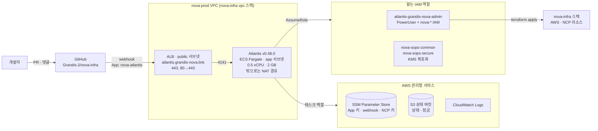
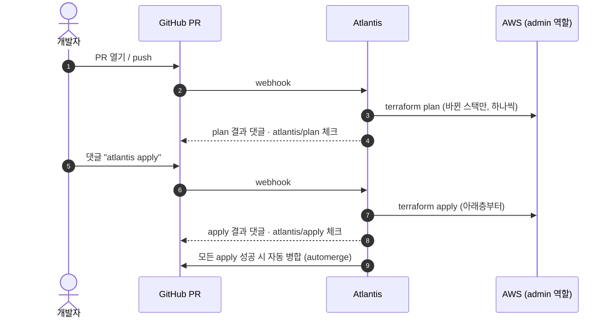

# atlantis-deploy

[nova-infra](https://github.com/Grandis-2/nova-infra)의 Terraform을 PR로 적용하는 **Atlantis 서버**를 AWS Fargate에 띄웁니다.

Atlantis가 자기 자신을 배포할 수는 없으므로, 이 저장소만 관리자가 직접 `terraform apply` 합니다. push만으로는 반영되지 않습니다.

## 아키텍처



VPC는 nova-infra의 `vpc` 스택을 원격 상태로 읽어 그대로 씁니다. 두 저장소는 상태 버킷으로만 연결됩니다.

| 구성 | 내용 |
| --- | --- |
| 컴퓨팅 | Fargate 0.5 vCPU · 2 GB, 태스크 1개 상시 실행. Atlantis `v0.48.0` 고정 |
| 네트워크 | ALB(public) → 태스크(app 서브넷). 태스크 보안 그룹은 ALB에서 오는 4141만 받음 |
| 인증서 · DNS | ACM `atlantis.grandis-nova.link` + Route 53 |
| 비밀 | `secrets.sops.yaml`(KMS 암호화)을 Terraform이 풀어 SSM SecureString에 넣음. 태스크는 시작할 때 읽음 |
| 로그 | CloudWatch Logs 14일 |

## 권한

| 역할 | 누가 | 할 수 있는 것 |
| --- | --- | --- |
| 태스크 역할 | Atlantis 태스크 | SSM 비밀 읽기, 상태 버킷 읽기 · 쓰기, 아래 두 역할 맡기, ECS Exec |
| `atlantis-grandis-nova-admin` | Atlantis (Terraform provider) | PowerUser + `nova-*` 이름의 IAM 리소스 쓰기 |
| `nova-sops-common` / `-secure` | Atlantis, 관리자 | KMS로 sops 파일 복호화 |
| `nova-readonly` | 사람 (로컬 plan) | ReadOnly + 상태 잠금 파일 쓰기. 비밀 값 · sops 복호화 불가 |

`nova-readonly`는 사람이 쓰는 역할이지만, Atlantis 역할과 함께 관리하려고 이 저장소에 둡니다.

## 보안 설정

- GitHub App으로 인증합니다. 개인 토큰이나 장기 AWS 키가 없습니다.
- webhook은 비밀값으로 서명을 확인합니다.
- `Grandis-2/nova-infra` 하나만 받습니다(`ATLANTIS_REPO_ALLOWLIST`).
- 저장소가 사용자 정의 workflow를 쓸 수 없습니다(`allow_custom_workflows = false`). 저장소가 바꿀 수 있는 서버 설정은 `apply_requirements` 하나뿐입니다.
- 웹 UI는 Basic 인증을 겁니다. 비밀번호는 SSM에 있습니다.
- ALB는 웹 UI 때문에 인터넷 전체에 열려 있습니다. webhook만 받게 하려면 `alb_ingress_cidr_blocks`를 GitHub webhook 대역(`https://api.github.com/meta`의 `hooks`)으로 좁힙니다.

## 주요 서버 설정

| 환경 변수 | 값 · 이유 |
| --- | --- |
| `ATLANTIS_CHECKOUT_STRATEGY` | `merge`. PR을 main과 합친 상태로 plan 해서, 그사이 main의 변경을 되돌리지 않습니다 |
| `ATLANTIS_GH_ALLOW_MERGEABLE_BYPASS_APPLY` | `true`. main 보호 규칙이 `atlantis/apply` 체크를 요구해도 apply 전 PR을 병합 가능으로 봅니다 |
| `ATLANTIS_HIDE_PREV_PLAN_COMMENTS` | `true`. 이전 plan 댓글을 접습니다 |
| `TF_VAR_assume_role_arn` | 인프라 스택의 provider가 맡을 admin 역할 |
| `TF_CLI_ARGS_init` | backend 버킷 · 리전. backend 블록에는 변수를 쓸 수 없어서 init 때 붙입니다 |

## PR 흐름



- main 보호 규칙이 `atlantis/apply` 체크를 요구하므로, apply 하지 않은 PR은 병합할 수 없습니다.
- 스택 순서, autoplan 대상, apply 조건은 nova-infra의 `atlantis.yaml`이 정합니다.

## 적용

관리자 세션(MFA)에서 실행합니다.

```bash
eval "$(aws configure export-credentials --profile infra-admin --format env)"
terraform init -backend-config=backend.hcl
terraform plan
terraform apply
```

태스크 정의가 바뀌면 Atlantis가 1~2분 동안 재시작합니다. 진행 중이던 plan과 잠금이 사라지므로, 다시 뜬 뒤 PR에 `atlantis plan`을 다시 답니다.

## 비밀 바꾸기

```bash
sops secrets.sops.yaml          # 평문으로 열고, 저장하면 다시 암호화
terraform apply                 # SSM 갱신
aws ecs update-service --cluster nova-atlantis --service nova-atlantis --force-new-deployment
```

`secrets.sops.yaml`의 키는 `github_app_key`, `ncloud_access_key`, `ncloud_secret_key`입니다. 파일이 없으면 비밀이 `CHANGE_ME`로 들어가고, Atlantis는 GitHub에 붙지 못합니다.

## nova-infra와 같아야 하는 값

| 값 | 이 저장소 | nova-infra |
| --- | --- | --- |
| `product` · `env` · `aws_region` · `tfstate_bucket` | `terraform.tfvars` | `terraform/variables/global.auto.tfvars` |
| 상태 버킷 · 리전 | `backend.hcl` | `.env`의 `TF_BACKEND_*` |
| sops 키 · 역할 | `.sops.yaml` (secure) | `terraform/aws/kms/grandis-nova/ap-northeast-2` |

## 처음부터 만들 때

1. nova-infra의 상태 버킷(init), sops 키(kms), VPC를 관리자 세션으로 먼저 적용합니다. 상태 버킷 절차는 nova-infra `terraform/aws/init/grandis-nova/backend.tf` 주석에 있습니다.
2. `secrets.sops.yaml`을 만들고 `sops --encrypt --in-place secrets.sops.yaml`로 암호화합니다.
3. 위 "적용"을 실행합니다.
4. GitHub App 설정의 Webhook URL과 secret에 `terraform output -raw atlantis_url_events`, `terraform output -raw webhook_secret` 값을 넣습니다.
5. nova-infra에 PR을 올려 plan 댓글이 달리는지 확인합니다.

## 웹 UI

```bash
aws ssm get-parameter --with-decryption --name "$(terraform output -raw web_password_parameter)" \
  --query Parameter.Value --output text      # 사용자 이름: atlantis
```
